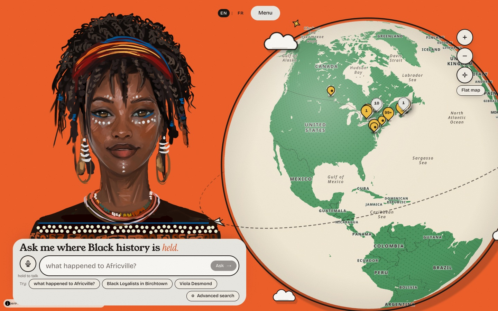
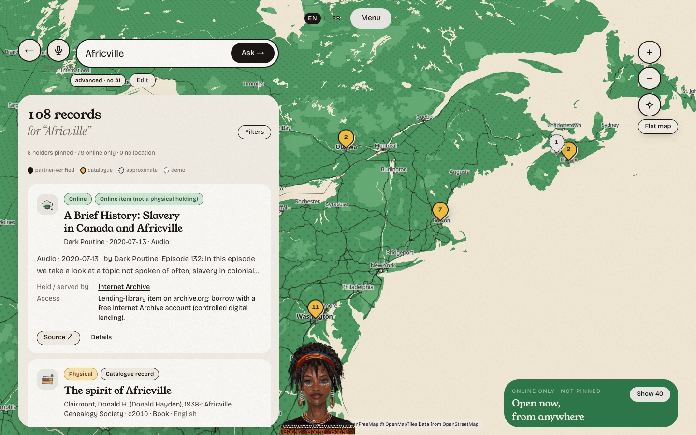
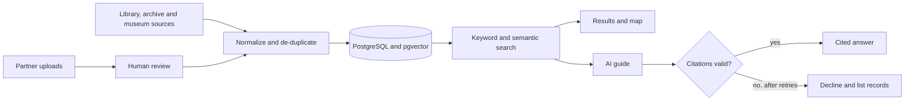

# Black History Discovery Hub

**A search engine for Black history that shows its sources.** Built by a student team for RBC HubHacks 2026
(Problem Statement 1, Black Cultural Centre for Nova Scotia).



## The problem

Records of Black history are spread across museums, archives, libraries and communities, each with its own catalogue.
A member of the public has to know where to look before they can look. Small institutions often cannot put their
holdings online at all.

## What it does

- **Searches many catalogues in one place.** Connectors read library, archive and museum sources and convert them
  into one shared record format.
- **Shows who holds each item.** Every result names its source and links back to the original record. Physical
  items appear on a map; online items are listed separately.
- **Answers questions with citations, or declines.** The AI guide may only use retrieved records. The server checks
  its citations before showing an answer. If the checks fail after retries, the guide declines and lists the records.
- **Lets small institutions join.** Partners can upload a spreadsheet or PDF, type records in, or photograph a
  shelf. A person reviews each record before it is published.
- **Works in English and French.**



## How it works



| Layer | Tools |
|---|---|
| Backend | Python 3.12, FastAPI, SQLAlchemy, Alembic |
| Data | PostgreSQL 16, SQL full-text search, pgvector, REST / OAI-PMH / SRU connectors |
| AI | Retrieval-augmented generation, reranking, server-side citation validation |
| Frontend | Next.js, TypeScript, Tailwind, MapLibre |

## Skills this project shows

| Skill | Where to look |
|---|---|
| Cleaning inconsistent data into one model | [`backend/app/adapters`](backend/app/adapters), [`core.py`](backend/app/models/core.py) |
| SQL and search ranking | [`search.py`](backend/app/services/search.py), [`migrations`](backend/migrations/versions) |
| Controls on AI output | [`guide.py`](backend/app/services/guide.py) |
| Source tracking and access controls | [`sources.md`](docs/sources.md), [`backend/tests`](backend/tests) |

## Run it

Requires [uv](https://docs.astral.sh/uv/) and Node 20+.

```bash
cp .env.example .env
make install && make db && make migrate && make seed
make api     # terminal 1: http://127.0.0.1:8000/docs
make web     # terminal 2: http://localhost:3000
make test    # 90 backend tests and a TypeScript check (passing 2026-11-24)
```

AI answers need an API key; search works without one. Setup, configuration and known limitations are in the
[technical reference](docs/TECHNICAL.md).

## Limitations

This is a hackathon MVP. Some source connectors need API keys, and one source blocks automated access. The
"Demo Partner" is fictional and its holdings are sample data.

## Credits

Team project for RBC HubHacks 2026. This repository is maintained by [Jesse (Siyuan) Xu](https://github.com/fclassjesse)
and was developed with AI coding tools (Claude Code). Code is under the [MIT License](LICENSE); indexed
descriptions remain with their holders.
